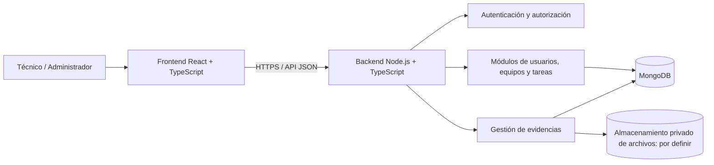
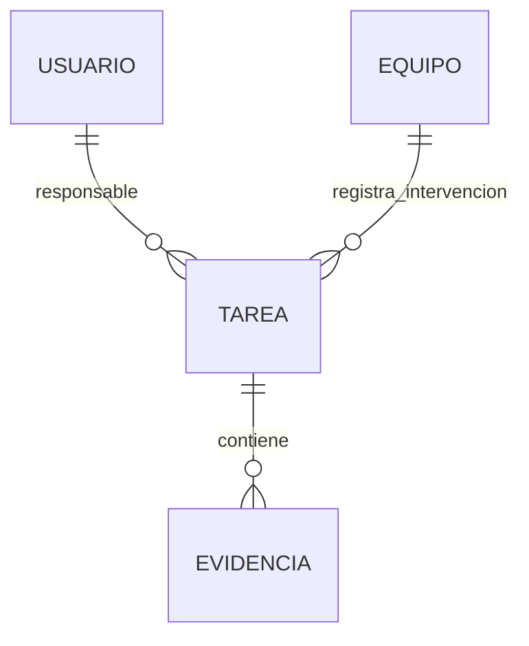

# Arquitectura de la Aplicación – TechTrack

**Proyecto:** TechTrack – Gestor de Soporte Técnico  
**Etapa del pipeline:** 4. Arquitectura  
**Versión:** 1.0  
**Estado:** Propuesta de arquitectura para HITL; no implica que sus componentes estén implementados.

## 1. Propósito y límites

Definir una solución técnica coherente con las 12 historias de usuario y los requisitos RF-01 a RF-14, RNF-01 a RNF-12 y RN-01 a RN-06 de `03-requerimientos.md`. El sistema debe preservar su rasgo diferencial: **tarea vinculada a equipo, diagnóstico, intervención, evidencia e historial**. No se introducen módulos de facturación, inventario empresarial, diagnóstico automático con IA ni plataforma multiempresa.

### 1.1. Entradas de arquitectura

- `02-descubrimiento.md`: objetivos, hipótesis y exclusiones.
- `03-requerimientos.md`: requisitos, restricciones y reglas de negocio.
- `04-product-backlog.md`: HU01–HU12 y escenarios de aceptación candidatos.
- `05-planificacion.md`: dependencias e incrementos de entrega.

### 1.2. Tecnologías conocidas

| Capa | Tecnología definida por el equipo |
|---|---|
| Interfaz web | React + TypeScript |
| Servidor/API | Node.js + TypeScript |
| Persistencia | MongoDB |
| Código y colaboración | Git + GitHub |
| Gestión ágil | Jira |

**Por definir:** framework HTTP exacto, librería de acceso a MongoDB, mecanismo de autenticación/sesión, estrategia de subida y almacenamiento de imágenes, proveedores de hosting, pruebas y CI. No se presenta ninguna de estas opciones como decisión previamente aprobada.

## 2. Estilo arquitectónico propuesto

Se recomienda una **aplicación web cliente–servidor con API HTTP/JSON**, separando frontend, backend y persistencia. Para un MVP de 12 HU, un **backend modular** con responsabilidades claras resulta más sencillo de desplegar y mantener que microservicios. Esta recomendación debe aprobarse mediante HITL.



El almacenamiento de archivos **no tiene proveedor confirmado**. Se propone guardar en MongoDB la **referencia/metadatos** del archivo y el contenido en almacenamiento adecuado, con acceso autorizado. La conveniencia de esta alternativa debe revisarse antes de HU09.

## 3. Descomposición lógica de componentes

| Componente | Responsabilidad | HU principales |
|---|---|---|
| Autenticación | Registro, ingreso, cierre de sesión, identidad | HU01, HU02 |
| Usuarios y roles | Consultas y autorización técnico/administrador | HU01, HU02, HU12 |
| Equipos | Registrar, identificar, seleccionar equipos | HU03, HU04 |
| Tareas | Crear, listar, consultar, actualizar estado | HU04, HU05, HU06, HU11 |
| Registros técnicos | Problema, diagnóstico, actividades, resultado | HU07, HU08 |
| Evidencias | Validar, registrar y recuperar imágenes autorizadas | HU09, HU11 |
| Historial | Consultar intervenciones vinculadas a un equipo | HU10 |
| Supervisión | Consulta de actividades por administrador | HU12 |

**Principio de diseño:** validar permisos y referencias en el backend, no confiar en que el frontend oculte botones.

## 4. Estructura de código recomendada

La organización exacta se ajustará al repositorio existente para **no sobrescribir código ya desarrollado**.

```text
TechTrack/
├── front/
│   └── src/
│       ├── app/              # Enrutamiento y proveedores
│       ├── features/         # auth, equipos, tareas, historial...
│       ├── components/       # Componentes reutilizables
│       ├── services/         # Cliente HTTP y adaptadores
│       ├── types/            # Tipos compartidos internos del front
│       └── styles/           # Estilos y tokens visuales
├── back/
│   └── src/
│       ├── modules/          # auth, usuarios, equipos, tareas, evidencias
│       ├── middleware/       # Autenticación, autorización y errores
│       ├── config/           # Configuración y variables de entorno
│       ├── infrastructure/   # MongoDB y almacenamiento de archivos
│       └── app.ts            # Composición de la API (nombre sugerido)
├── docs/
└── README.md
```

Organizar cada módulo del backend, cuando aplique, en rutas/controlador, servicio, repositorio, validaciones y tipos. Evitar acoplar la lógica de negocio directamente a componentes React o a handlers HTTP.

## 5. Modelo de datos conceptual

Es una propuesta **conceptual**, no un esquema físico MongoDB ni un contrato ya aprobado. Se detallan relaciones necesarias para el producto.

| Entidad / colección candidata | Datos relevantes | Relación |
|---|---|---|
| `usuarios` | ID, nombre, identificador de acceso, hash de contraseña, rol | Usuario responsable de tareas |
| `equipos` | ID, descripción, tipo, marca, modelo, serial | Un equipo puede tener múltiples tareas |
| `tareas` | ID, ID equipo, ID técnico, descripción, estado, fechas, registro técnico | Cada tarea referencia un equipo |
| `evidencias` | ID, ID tarea, nombre/tipo/tamaño, referencia privada de archivo | Una tarea puede tener múltiples evidencias |

**Alternativa de implementación:** almacenar problema, diagnóstico, actividades y resultado **dentro del documento de tarea** si el alcance y los patrones de consulta lo justifican; una colección independiente de intervenciones solo si existe una necesidad demostrada. El historial puede derivarse de las tareas del equipo, evitando una copia inconsistente de información.



### 5.1. Integridad y consistencia

- Validar existencia de equipo antes de crear tarea (RN-01; RNF-04).
- Validar existencia y autorización de tarea antes de registrar diagnóstico o evidencia (RN-03).
- Consultar historial filtrando por **identificador de equipo** (RN-04).
- No permitir referencias a recursos inexistentes ni una confirmación visual si la persistencia falla (RNF-11).
- Definir qué ocurre si se intenta borrar un equipo o tarea con historial; regla aún pendiente.

### 5.2. Índices sugeridos para evaluar

- Usuarios: identificador de acceso único, cuando el equipo defina ese campo.
- Tareas: `equipoId` para historial; `tecnicoId` y `estado` para consultas frecuentes.
- Evidencias: `tareaId`.

Estas sugerencias requieren verificación con esquema y consultas reales; no afirmar que los índices ya fueron creados.

## 6. Diseño inicial de API (candidatos, no rutas implementadas)

Se propone mantener una API versión inicial consistente, por ejemplo `/api/...`. Los nombres definitivos deberán conciliarse con el código, los tipos y las HU.

| Operación requerida | Método / ruta candidata | HU |
|---|---|---|
| Registrar usuario | `POST /api/auth/register` | HU01 |
| Iniciar sesión | `POST /api/auth/login` | HU02 |
| Cerrar sesión | `POST /api/auth/logout` | HU02 |
| Registrar equipo | `POST /api/equipos` | HU03 |
| Consultar equipos | `GET /api/equipos` | HU03, HU04 |
| Crear tarea | `POST /api/tareas` | HU04 |
| Consultar tareas | `GET /api/tareas` | HU05 |
| Actualizar estado | `PATCH /api/tareas/:id/estado` | HU06 |
| Registrar problema y diagnóstico | `PATCH /api/tareas/:id/diagnostico` | HU07 |
| Registrar intervención | `PATCH /api/tareas/:id/intervencion` | HU08 |
| Adjuntar evidencia | `POST /api/tareas/:id/evidencias` | HU09 |
| Historial del equipo | `GET /api/equipos/:id/historial` | HU10 |
| Detalle de tarea | `GET /api/tareas/:id` | HU11 |
| Supervisión | `GET /api/admin/actividades` | HU12 |

**Contrato por definir:** esquema de request/response, convenciones de errores, paginación, límites de tamaño, validación, política de autorización y códigos HTTP. El backend debe aplicar las validaciones incluso si el cliente web fue manipulado.

## 7. Atributos de calidad y tácticas arquitectónicas

| RNF | Riesgo | Táctica propuesta | Comprobación posterior |
|---|---|---|---|
| RNF-01/02 | Acceso indebido | Middleware de autenticación y permisos en servidor | Pruebas de sesión y roles |
| RNF-03 | Filtración de credenciales | Hash robusto con sal; no registrar contraseñas | Revisión de persistencia y logs |
| RNF-04 | Referencias inválidas | Validación de IDs y existencia de relaciones | Casos negativos de API |
| RNF-05/06 | Flujo confuso en móvil | Componentes reutilizables, estados y errores claros, diseño responsive | Pruebas visuales y recorrido |
| RNF-07/08 | Archivos peligrosos o expuestos | Validación de tipo/tamaño; almacenamiento privado y autorización | Pruebas de carga y acceso |
| RNF-09 | Respuestas lentas | Consultas dirigidas, índices y medición | Medición con entorno/carga definida |
| RNF-10/12 | Cambios difíciles de probar | TypeScript, módulos, revisiones y CI | Linter, tests, PR y trazabilidad |
| RNF-11 | Confirmaciones falsas | Manejo uniforme de errores y resultados de persistencia | Pruebas de fallos |

No se asignan metas numéricas de latencia, disponibilidad o capacidad sin validación del equipo.

## 8. Escenarios de evaluación arquitectónica (inspirados en ATAM)

Se propone evaluar alternativas frente a escenarios concretos, sin afirmar haber realizado un taller ATAM formal:

1. **Seguridad:** un técnico cambia manualmente la URL para leer una tarea ajena; el servidor debe aplicar autorización y rechazar el acceso no permitido.
2. **Integridad:** el cliente solicita guardar una tarea con `equipoId` inexistente; la API debe rechazarla sin crear registros huérfanos.
3. **Privacidad:** un usuario sin sesión intenta abrir la URL de una evidencia; la información debe permanecer protegida.
4. **Mantenibilidad:** agregar un campo de diagnóstico no debería obligar a reescribir módulos ajenos; revisar acoplamiento y pruebas.
5. **Usabilidad:** el técnico debe poder terminar el flujo esencial desde pantalla móvil y escritorio sin perder datos.

**Evaluación pendiente:** describir alternativas consideradas, trade-offs, decisiones y resultados de pruebas. Los escenarios aún son candidatos.

## 9. Decisiones arquitectónicas que requieren HITL

| ID ADR | Decisión pendiente | Alternativas o interrogantes | Responsable de cierre |
|---|---|---|---|
| ADR-001 | Framework HTTP | Express, Fastify u otro compatible con Node/TS | Backend y equipo |
| ADR-002 | Acceso a MongoDB | Driver directo, ODM u otra capa | Backend, BD y equipo |
| ADR-003 | Autenticación | Cookies de sesión, token u otro mecanismo adecuado | Equipo con revisión de seguridad |
| ADR-004 | Gestión de imágenes | Proveedor/ubicación; metadatos y control de acceso | Backend y equipo |
| ADR-005 | Datos técnicos | Campos embebidos en tareas o entidad separada | Equipo |
| ADR-006 | API y validación | Contratos, biblioteca de validación y formato de errores | Frontend y backend |
| ADR-007 | Hosting | Frontend, API y MongoDB; costos y restricciones | Despliegue y equipo |

**Formato de ADR:** contexto, opciones, criterios, decisión adoptada, consecuencias, fecha, responsable, evidencia HITL. Registrar decisión real, no seleccionar automáticamente la opción que propone la IA.

## 10. Uso de IA y HITL

**IA:** apoya alternativas de componentes, API, modelo de datos, identificación de riesgos y revisión de atributos de calidad.  
**HITL:** el equipo evalúa cada decisión frente a RF/RNF/RN y al plazo del MVP; acepta, modifica o rechaza, documentando el porqué.  
**Evidencia:** `docs/evidencias-ia/etapas/04-arquitectura/` y ADR versionados en el repositorio.

**Criterio de salida:** decisiones suficientes y aprobadas para implementar las HU del Sprint sin introducir dependencias inseguras o inconsistencias de datos. La arquitectura se actualizará cuando las pruebas o el código justifiquen cambios.
