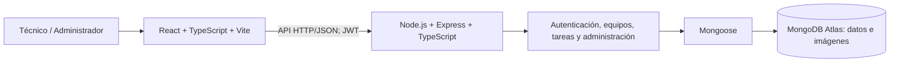

# Arquitectura de la Aplicación — TechTrack

**Proyecto:** TechTrack — Gestor de Soporte Técnico  
**Etapa del pipeline:** 04. Arquitectura  
**Versión:** 2.0  
**Estado:** Arquitectura implementada; despliegue público aún no verificado.

## 1. Decisión arquitectónica

TechTrack emplea una **arquitectura web cliente-servidor**, con frontend React/Vite, backend modular Express y persistencia MongoDB Atlas mediante Mongoose. No se adoptaron microservicios. El alcance funcional se define en [Requerimientos](03-requerimientos.md).



En ejecución local se usa HTTP; en una publicación pública se requiere comprobar HTTPS y la configuración de orígenes permitidos.

## 2. Estructura y responsabilidades

```text
front/src/
  api.ts                   # Cliente HTTP y respuestas de error
  components/AuthScreen.tsx
  TechTrackApp.tsx         # Consola principal
  types.ts                 # Contratos del cliente
  TechTrackApp.css
back/src/
  app.ts                   # Instancia Express y rutas
  server.ts                # Arranque local y conexión
  config/                  # Entorno y conexión a MongoDB
  middleware/              # Autenticación y roles
  models/                  # User, Equipment, Task, Evidence
  modules/                 # auth, equipment, tasks, admin
  utils/                   # Utilidades y errores
```

El frontend presenta formularios y conserva el estado visual; **las validaciones de autorización corresponden al backend**. Los módulos del servidor implementan las reglas de negocio y consultan los modelos. La documentación técnica complementaria está en `documentacion/guia-tecnica.md`.

## 3. Modelo de datos y relaciones

| Modelo | Campos destacados | Relación |
|---|---|---|
| `User` | `name`, `email`, `passwordHash`, `role`, `tokenVersion` | Propietario de equipos y tareas |
| `Equipment` | `owner`, `assetTag`, `name`, `type`, `brand`, `model`, `serialNumber` | Equipo de un técnico |
| `Task` | `owner`, `equipment`, `status`, `problemReported`, `diagnosis`, `activities`, `result`, `recommendations` | Intervención ligada a equipo |
| `Evidence` | `task`, `owner`, `filename`, `mimeType`, `size`, `data`, `uploadedAt` | Imagen binaria de una tarea |

El identificador `assetTag` es único por propietario mediante índice compuesto `owner + assetTag`; el serial no exige unicidad. El historial se construye desde las tareas del equipo. La documentación técnica está integrada en `Task`, no en una colección autónoma.

Las imágenes JPEG, PNG y WEBP se almacenan **como binarios en MongoDB**, no en un servidor externo de archivos; el límite de la aplicación es **5 MB** por imagen. Su lectura exige autenticación y autorización.

## 4. Estados, sesión y seguridad

- Estados de tarea: `PENDING → IN_PROGRESS → COMPLETED`; el servidor comprueba transiciones.
- Las tareas completadas no permiten editar documentación ni agregar evidencias.
- La autenticación utiliza JWT; el cierre de sesión incrementa `tokenVersion` y revoca sesiones anteriores de la cuenta.
- Contraseñas protegidas mediante bcrypt; entradas validadas con Zod; Helmet, CORS y limitación de intentos en autenticación.
- Las consultas técnicas filtran por propietario; los endpoints administrativos requieren rol `ADMIN`.
- El frontend debe limpiar datos de sesión para evitar información residual; el defecto de aislamiento detectado fue corregido y sometido a regresión.

El uso del token en el navegador y otros controles de producción requieren revisión adicional antes de una publicación abierta.

## 5. API real

Todas las rutas usan el prefijo `/api`. Salvo salud, registro y login, se requiere autenticación.

| Módulo | Método y ruta | Propósito |
|---|---|---|
| Salud | `GET /api/health` | Respuesta de la API; no prueba por sí sola la conexión DB |
| Autenticación | `POST /api/auth/register` · `POST /api/auth/login` | Crear cuenta y autenticar |
| Autenticación | `GET /api/auth/me` · `POST /api/auth/logout` | Identidad y revocación |
| Equipos | `GET/POST /api/equipment` | Listar y registrar |
| Equipos | `GET /api/equipment/:id/history` | Historial de equipo |
| Tareas | `GET/POST /api/tasks` · `GET /api/tasks/:id` | Listar, crear y detallar |
| Tareas | `PATCH /api/tasks/:id/status` | Cambiar estado |
| Tareas | `PATCH /api/tasks/:id/documentation` | Guardar registro técnico |
| Evidencias | `POST /api/tasks/:id/evidence` | Adjuntar imagen |
| Evidencias | `GET /api/tasks/:id/evidence/:evidenceId/content` | Recuperar imagen autorizada |
| Administración | `GET /api/admin/technicians` · `GET /api/admin/activities` | Listar técnicos y actividad |
| Administración | `POST /api/admin/tasks` · `GET /api/admin/tasks/:id` | Asignar y consultar tarea |
| Administración | `GET /api/admin/tasks/:taskId/evidence/:evidenceId/content` | Recuperar imagen administrativa |

La API devuelve estados HTTP controlados para validación, autenticación, permisos, ausencia de recursos y conflictos. Los cambios correctivos y los resultados de estas comprobaciones pertenecen a [Pruebas](07-pruebas.md).

## 6. Calidad y decisiones pendientes

La modularidad facilita localizar responsabilidades; no constituye una medición de mantenibilidad. Los escenarios de seguridad e integridad inspirados en ATAM se verificaron parcialmente mediante QA, **sin realizar un taller ATAM formal**. Las pruebas de carga y escalabilidad permanecen pendientes.

La implementación conserva particularidades de HU08 y HU12 que afectan criterios de aceptación; su explicación se centraliza en [Pruebas](07-pruebas.md). Para la publicación en Vercel deben comprobarse la inicialización de MongoDB y los límites de archivos, según [08-despliegue.md](08-despliegue.md).

**Decisiones técnicas aplicadas:** Express, Mongoose, JWT, almacenamiento de imágenes en MongoDB y documentación de intervenciones en `Task`. La aprobación humana de cada decisión se refleja solo cuando existen evidencias en `evidencias-ia/etapas/04-arquitectura/`; la presencia de código no prueba por sí sola una ADR firmada.
