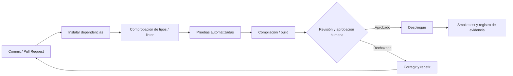

# Integración Continua, Entrega y Despliegue – TechTrack

**Proyecto:** TechTrack – Gestor de Soporte Técnico  
**Etapa del pipeline:** 7. CI/CD y despliegue  
**Versión:** 1.0  
**Estado:** Plan de despliegue; proveedor, configuración real y URL no confirmados en las fuentes.

## 1. Objetivo

Describir cómo preparar, integrar, verificar y publicar el MVP de TechTrack de forma reproducible y segura. El objetivo de la entrega académica es contar con una **aplicación funcional**, un **repositorio accesible** y una **demostración verificable**, no afirmar que existe un despliegue que aún no ha sido comprobado.

## 2. Elementos de la solución

| Componente | Tecnología conocida | Entorno / servicio |
|---|---|---|
| Interfaz | React + TypeScript | Por seleccionar y confirmar |
| API | Node.js + TypeScript | Por seleccionar y confirmar |
| Datos | MongoDB | Instancia y acceso por configurar |
| Evidencias | Imágenes vinculadas con tareas | Proveedor/volumen/permiso por decidir |
| Código | Git + GitHub | Repositorio y ramas reales por registrar |
| Seguimiento | Jira | Proyecto y claves reales por vincular |

La arquitectura recomendada se describe en `06-arquitectura.md`. No sustituir decisiones técnicas ya implementadas sin revisión del equipo.

## 3. Entornos de ejecución

| Entorno | Uso | Precauciones |
|---|---|---|
| Local | Desarrollo y pruebas rápidas | Variables privadas fuera de Git |
| Pruebas o preproducción (opcional) | Integración y validación antes de publicar | Datos ficticios y control de acceso |
| Entrega / demostración | Presentación del MVP y aceptación | Versión fija, credenciales de prueba seguras y monitoreo básico |

La existencia de un entorno de pruebas separado es **recomendación**, no condición ya cumplida.

## 4. Preparación de configuración

En el repositorio deberán verificarse, según la implementación real:

- `front/` y `back/` con instrucciones y scripts reproducibles.
- `.gitignore` que excluya dependencias, archivos `.env` reales, tokens, claves y artefactos temporales.
- Ejemplos de variables de entorno sin valores sensibles.
- Orígenes permitidos (CORS) definidos y restringidos para la API.
- Conexión cifrada a datos y a la API en un despliegue público.
- Reglas de almacenamiento y acceso a evidencias privadas.
- Configuración de autenticación adecuada al mecanismo elegido.
- Estrategia de inicialización de datos de prueba; no exponer cuentas de administración públicas.

### 4.1. Variables de entorno de referencia

**Ejemplo de nombres, por conciliar con el código:**

```dotenv
# Backend - EJEMPLO; no usar valores reales aquí
NODE_ENV=development
PORT=3000
MONGODB_URI=<CONFIGURAR_LOCALMENTE_O_COMO_SECRETO>
ALLOWED_ORIGINS=<URL_DEL_FRONTEND>
SESSION_OR_TOKEN_SECRET=<SECRETO_EN_GESTOR_SEGURO>
FILE_STORAGE_CONFIG=<SEGUN_PROVEEDOR_ELEGIDO>

# Frontend - EJEMPLO
VITE_API_BASE_URL=<URL_DE_LA_API>
```

`SESSION_OR_TOKEN_SECRET` es solo un nombre orientativo: debe ajustarse al mecanismo real. La configuración privada se introduce en el entorno o gestor de secretos, **nunca se sube a GitHub**. Las variables de frontend públicas no deben contener secretos.

## 5. Pipeline CI/CD propuesto

Diferenciamos el pipeline de **ingeniería de software aumentada con IA** (`01-pipeline.md`) del pipeline **automatizado de integración y despliegue** (CI/CD) de este documento.



**Regla operativa:** ningún resultado generado por IA debe llegar directamente a producción sin revisión y comprobaciones reales. El flujo anterior **aún no equivale a un workflow GitHub Actions creado o ejecutado**.

### 5.1. Controles mínimos propuestos

| Puerta | Criterio verificable |
|---|---|
| Dependencias | Instalación completa y sin errores que impidan compilar |
| Calidad | TypeScript y herramientas de formato/lint seleccionadas sin fallos bloqueantes |
| Pruebas | Conjunto relevante ejecutado, resultados registrados |
| Build | Frontend y backend generan artefactos o ejecutables válidos según configuración |
| Secretos | Ningún secreto real incluido en código, historial o logs |
| Aprobación HITL | Integrante responsable revisa PR/commit y autoriza despliegue |
| Smoke test | Flujo crítico funciona en el entorno publicado |

Las órdenes exactas de instalación, compilación y arranque se extraerán de los `package.json` reales; no se asume que utilicen scripts `build`, `test` o `lint` hasta verificarlos.

## 6. Secuencia de despliegue controlado

1. **Preparar:** escoger rama/commit exacto y confirmar checklist de calidad.
2. **Configurar:** crear servicios según arquitectura, definir URL de API, conexión MongoDB, permisos y almacenamiento de evidencias.
3. **Proteger:** introducir credenciales mediante secretos del proveedor; validar CORS, políticas de acceso y HTTPS cuando corresponda.
4. **Desplegar backend:** publicar una versión de la API y verificar que inicia sin errores.
5. **Desplegar frontend:** configurar la URL de API correcta y construir/publicar la interfaz.
6. **Probar:** ejecutar smoke test con usuarios y equipos ficticios.
7. **Registrar:** guardar enlaces, hora, versión, resultados, responsables y evidencias de operación.
8. **Resolver o revertir:** si hay fallo crítico, retirar la versión defectuosa o restaurar la última versión estable disponible según el proveedor.

**No se declara un orden universal de dependencias:** la secuencia concreta se adapta al proveedor y a la arquitectura aprobada.

## 7. Checklist de verificación posterior al despliegue

- [ ] El frontend carga desde la URL indicada.
- [ ] La API responde desde su endpoint de comprobación real o una operación segura.
- [ ] MongoDB está conectado y la persistencia fue comprobada.
- [ ] Se pueden registrar/iniciar sesión usuarios de prueba conforme al alcance implementado.
- [ ] Se puede registrar o seleccionar equipo.
- [ ] Se puede crear y consultar tarea; un cambio de estado persiste.
- [ ] El problema, diagnóstico y actividades quedan asociados a la tarea, si las HU correspondientes están implementadas.
- [ ] Se pueden adjuntar/consultar evidencias de forma autorizada, si HU09 está implementada.
- [ ] El historial del equipo presenta intervenciones correctas, si HU10 está implementada.
- [ ] Los permisos de administrador y técnico se comportan correctamente.
- [ ] No se muestran credenciales, trazas sensibles ni URLs públicas de archivos privados.
- [ ] Se registró la versión de código y los resultados reales.

Marcar cada casilla **solo después de comprobarla**. Si una HU está fuera del incremento, registrar **No aplica a esta versión** con justificación.

## 8. Registro de despliegue (plantilla)

| Campo | Valor por registrar |
|---|---|
| Fecha y hora | No reportada |
| Responsable | No reportado |
| Repositorio / rama / commit | Pendiente de asociar |
| Proveedor frontend | Pendiente |
| Proveedor backend | Pendiente |
| Base de datos / almacenamiento | Pendiente |
| URL aplicación | Pendiente |
| URL API (si es publicable) | Pendiente |
| Resultado del build | No ejecutado en este documento |
| Resultado de smoke test | No ejecutado en este documento |
| Defectos / acciones correctivas | Pendiente de observaciones |
| Decisión HITL | Pendiente de aprobación de esta propuesta |
| Evidencias | Referencias reales de PR, logs y capturas |

## 9. Gestión de riesgos y recuperación

- **Fallo de conexión:** verificar secretos y reglas de red sin imprimir URI completas en logs.
- **CORS:** configurar orígenes conocidos en lugar de permitir indiscriminadamente todos los dominios.
- **Archivos:** prevenir exposición por rutas directas sin autorización; validar tipo y tamaño.
- **Cambios de esquema:** respaldar datos pertinentes y documentar pasos reversibles antes de cambios destructivos.
- **Disponibilidad del proveedor:** guardar instrucciones para reconstruir la aplicación en un entorno alternativo si falla la demo.
- **Rollback:** conservar el commit/artefacto previo, revisar compatibilidad con cambios de datos y seguir mecanismo del proveedor elegido.

Para el MVP académico se pueden utilizar **datos ficticios** y una estrategia simple, pero documentada, de recuperación.

## 10. Uso de IA y HITL

**Aportes posibles de IA:** proponer configuraciones, explicar fallos, revisar seguridad de variables, sugerir pruebas de humo y redactar instrucciones.  
**Validación humana:** comprobar los comandos, dependencias, permisos, secretos y resultados. Toda acción que altere servicios, datos o entornos debe aprobarla el responsable.  
**Evidencia:** `docs/evidencias-ia/etapas/07-ci-cd/`; enlaces a workflows/commits reales y registro del despliegue.

**Salida hacia evaluación:** versión publicada o procedimiento local demostrable, más resultados efectivos de pruebas. La existencia de esta guía **no significa que TechTrack ya esté desplegado**.
x