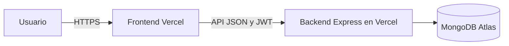

# Integración y Despliegue Manual en Vercel — TechTrack

**Proyecto:** TechTrack — Gestor de Soporte Técnico  
**Etapa del pipeline:** 07. Integración y despliegue  
**Versión:** 2.0  
**Estado:** Publicación manual prevista; despliegue público y smoke test aún no verificados.

## 1. Decisión de entrega

La publicación se realizará **manualmente en Vercel**, con dos proyectos independientes dentro del mismo repositorio: `front/` para React/Vite y `back/` para Express. MongoDB Atlas seguirá siendo la base de datos y el almacenamiento de evidencias.

**No se implementará un workflow CI/CD automatizado para esta entrega.** Conectar GitHub a Vercel puede habilitar despliegues automáticos; si se necesita control estrictamente manual, se deberán desactivar esos disparadores o publicar explícitamente con Vercel CLI. Este documento es un **procedimiento**, no constancia de publicación.



## 2. Requisitos antes de publicar

1. Revisar y confirmar en Git los cambios de código corregidos y probados. La última QA incluyó modificaciones locales **no contenidas en el HEAD por sí solo**.
2. Ejecutar en la versión elegida los builds y las pruebas relevantes:

   ```powershell
   npm install --prefix back
   npm install --prefix front
   npm run build --prefix back
   npm run build --prefix front
   npm test --prefix back
   ```

3. Comprobar que `.env`, secretos y credenciales no estén versionados.
4. Preparar el acceso seguro desde Vercel a MongoDB Atlas y usuarios de demostración ficticios.

Las instrucciones de ejecución local completas pertenecen a `README.md` y `documentacion/guia-tecnica.md`.

## 3. Variables de entorno

| Proyecto | Variable | Propósito |
|---|---|---|
| Backend (`back/`) | `MONGODB_URI` | Conexión privada a Atlas |
| Backend | `JWT_SECRET` | Firma de tokens; secreto privado robusto |
| Backend | `JWT_EXPIRES_IN` | Duración del token (implementación: `8h` por defecto) |
| Backend | `CLIENT_ORIGIN` | **Origen exacto** del frontend público para CORS |
| Backend local | `PORT` | Puerto de ejecución local; Vercel gestiona el servicio público |
| Frontend (`front/`) | `VITE_API_URL` | URL del backend **con `/api`** al final |

Ejemplo sin credenciales:

```dotenv
# Configuración privada del backend en Vercel
MONGODB_URI=<URI_PRIVADA_ATLAS>
JWT_SECRET=<SECRETO_PRIVADO>
JWT_EXPIRES_IN=8h
CLIENT_ORIGIN=https://FRONTEND.vercel.app

# Configuración del proyecto frontend
VITE_API_URL=https://BACKEND.vercel.app/api
```

`VITE_API_URL` es el nombre utilizado por el código; las variables `VITE_` se exponen al cliente y nunca deben contener secretos.

## 4. Dos adaptaciones o riesgos críticos

**Conexión Express–MongoDB.** El repositorio exporta Express desde `back/src/app.ts`, pero en ejecución local abre MongoDB desde `back/src/server.ts`. Antes de desplegar la entrada Express en Vercel Functions hay que **adaptar o comprobar la inicialización de la conexión** en ese entorno, reutilizar conexiones cuando proceda y realizar lecturas/escrituras autorizadas. `GET /api/health` por sí solo no garantiza una conexión funcional con Atlas.

**Tamaño de imágenes.** TechTrack acepta imágenes de hasta **5 MB**, mientras Vercel Functions limita el cuerpo de solicitud o respuesta a **4,5 MB**. Debe ajustarse el límite efectivo o la estrategia de transferencia antes de afirmar que toda la funcionalidad de evidencias es compatible con el entorno publicado. Un archivo multipart también añade sobrecarga. [Documentación oficial de límites](https://vercel.com/docs/functions/limitations).

Se debe revisar además la conectividad de Atlas desde Vercel: la IP local autorizada puede no servir para funciones con IP de salida dinámica. No se recomienda abrir el acceso de red indiscriminadamente como solución por defecto.

## 5. Publicación manual paso a paso

1. **Backend:** crear un proyecto en Vercel con **Root Directory `back`**; comprobar la detección de Express y su punto de entrada; configurar secretos y Atlas; desplegar y probar la API y persistencia.
2. **Frontend:** crear otro proyecto con **Root Directory `front`**, framework Vite, build `npm run build`, directorio de salida `dist`; configurar `VITE_API_URL` y desplegar.
3. **Conexión:** configurar `CLIENT_ORIGIN` con el dominio final del frontend. Volver a desplegar la configuración que lo requiera.
4. **Prueba de humo:** ejecutar el recorrido crítico descrito abajo con datos de prueba.
5. **Registro:** conservar enlaces, proyecto, rama, commit, resultados, incidencias y autorización del equipo.

Alternativa manual mediante CLI, ejecutada **por separado** desde cada directorio vinculado al proyecto correcto:

```powershell
vercel link
vercel deploy
vercel deploy --prod
```

Si se usa integración con Git, controlar el despliegue automático según la [configuración de Git de Vercel](https://vercel.com/docs/project-configuration/git-configuration). No se ha confirmado todavía el método definitivo dentro de la modalidad manual.

## 6. Smoke test después de publicar

- [ ] El frontend abre y se comunica con el backend por HTTPS.
- [ ] La API atiende solicitudes y **MongoDB persiste** información de prueba.
- [ ] Registro, login y cierre de sesión funcionan.
- [ ] Equipo → tarea → cambio de estado → diagnóstico → actividades → evidencia pequeña → historial funciona después de recargar.
- [ ] Las imágenes se recuperan con autorización y dentro del tamaño que admita Vercel.
- [ ] Se rechazan accesos anónimos, entre técnicos y al módulo administrativo sin rol.
- [ ] No se exponen credenciales ni errores sensibles.
- [ ] El equipo registra las limitaciones conocidas, las URL y el commit publicado.

Este smoke test **no sustituye** las pruebas por criterio de aceptación ni corrige automáticamente las diferencias funcionales conocidas; los resultados previos constan en [07-pruebas.md](07-pruebas.md).

## 7. Registro de evidencia y recuperación

| Campo | Estado actual |
|---|---|
| Proyectos Vercel y URL frontend/backend | Pendientes |
| Rama y commit publicado | Pendientes |
| Configuración final sin secretos | Pendiente |
| Builds de Vercel y logs | No ejecutados en este documento |
| Smoke test de producción | Pendiente |
| Revisión y autorización HITL | Pendiente de registrar |

Si falla la publicación, revisar logs y variables, corregir el problema y, si existe una versión anterior estable, revertir el despliegue. **Revertir código no revierte automáticamente los datos de Atlas.** La alternativa de demostración es conservar instrucciones de ejecución local.

**Evidencias:** `evidencias-ia/etapas/07-ci-cd/` y registros de Vercel cuando existan. **Estado final:** procedimiento manual definido; publicación aún no acreditada.
