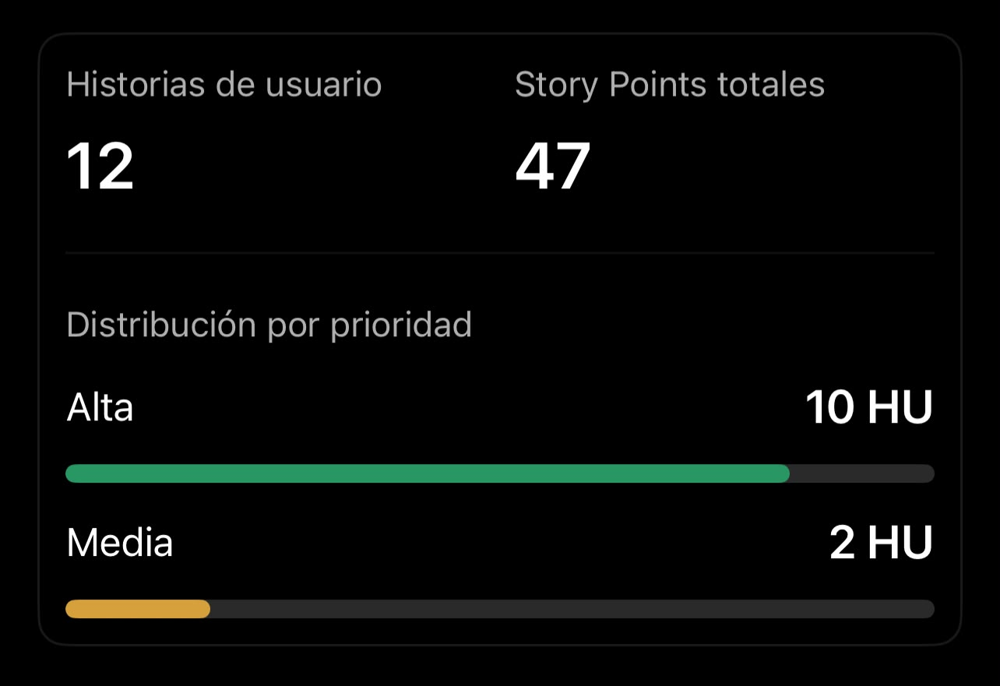

# Respuesta de IA compartida — historias de usuario y criterios de aceptación

**Etapa principal:** 02. Requerimientos  
**Adjunto:** `adjuntos/resumen-hu-story-points.png` (imagen aportada por el equipo con totales y prioridades).

---

## 1. Historias de usuario definidas

Se definieron 12 historias de usuario para cubrir el flujo principal de la aplicación, desde el acceso del técnico hasta la documentación y consulta de las intervenciones realizadas.

### Bloque 1. Acceso y gestión del trabajo

#### HU01 — Registro de usuario

**Historia:** Como técnico, quiero registrarme para poder utilizar la aplicación.

**Criterios de aceptación:**

- El usuario puede ingresar los datos requeridos para registrarse.
- El sistema valida que los campos obligatorios estén completos.
- El sistema evita registrar un correo que ya exista.
- Si el registro es válido, se crea la cuenta y se confirma el registro.
- Si hay datos inválidos, el sistema informa el error y no crea la cuenta.

**Prioridad:** Alta.  
**Story Points:** 3.

#### HU02 — Inicio de sesión

**Historia:** Como técnico, quiero iniciar sesión para acceder de forma segura a mis tareas.

**Criterios de aceptación:**

- El usuario puede ingresar sus credenciales.
- El sistema valida las credenciales.
- Con credenciales válidas, el usuario accede a la aplicación.
- Con credenciales inválidas, el sistema muestra un mensaje de error.
- El usuario no puede acceder a las funciones protegidas sin autenticarse.

**Prioridad:** Alta.  
**Story Points:** 3.

#### HU03 — Registro de equipos

**Historia:** Como técnico, quiero registrar un equipo para asociarlo a actividades de soporte.

**Criterios de aceptación:**

- El técnico puede registrar un equipo con la información básica requerida.
- El sistema valida los campos obligatorios.
- El identificador o número de serie no puede duplicarse cuando corresponda.
- El equipo registrado queda disponible para asociarlo a tareas.
- El sistema confirma el registro exitoso.

**Prioridad:** Alta.  
**Story Points:** 3.

#### HU04 — Creación de tareas técnicas

**Historia:** Como técnico, quiero crear una tarea para registrar un trabajo técnico pendiente.

**Criterios de aceptación:**

- El técnico puede crear una tarea indicando la actividad a realizar.
- La tarea puede asociarse a un equipo registrado.
- La tarea registra la información básica necesaria para realizar el trabajo.
- Una tarea nueva queda inicialmente en estado Pendiente.
- La tarea aparece en la lista de tareas del técnico.

**Prioridad:** Alta.  
**Story Points:** 5.

#### HU05 — Consulta de tareas

**Historia:** Como técnico, quiero consultar mis tareas para saber qué actividades tengo pendientes.

**Criterios de aceptación:**

- El técnico puede visualizar sus tareas.
- Cada tarea muestra al menos su título, equipo asociado y estado.
- El técnico puede identificar las tareas pendientes, en progreso y completadas.
- La lista se actualiza cuando se crean o modifican tareas.

**Prioridad:** Alta.  
**Story Points:** 3.

#### HU06 — Gestión del estado de tareas

**Historia:** Como técnico, quiero cambiar el estado de una tarea para indicar si está pendiente, en progreso o completada.

**Criterios de aceptación:**

- El técnico puede cambiar el estado de una tarea.
- Los estados disponibles son Pendiente, En progreso y Completada.
- El sistema guarda el nuevo estado.
- El nuevo estado se refleja en la lista y detalle de la tarea.
- Una tarea completada no pierde la información previamente registrada.

**Prioridad:** Alta.  
**Story Points:** 2.

### Bloque 2. Documentación y consulta

#### HU07 — Registro de problema y diagnóstico

**Historia:** Como técnico, quiero registrar el problema reportado y el diagnóstico de un equipo para documentar la situación encontrada.

**Criterios de aceptación:**

- El técnico puede registrar el problema reportado.
- El técnico puede registrar el diagnóstico realizado.
- La información queda asociada a la tarea y al equipo correspondiente.
- El sistema permite editar la información mientras la tarea no haya finalizado.
- La información registrada queda disponible en el detalle de la tarea.

**Prioridad:** Alta.  
**Story Points:** 5.

#### HU08 — Registro de actividades realizadas

**Historia:** Como técnico, quiero registrar las actividades realizadas para conservar un historial del trabajo técnico.

**Criterios de aceptación:**

- El técnico puede registrar las actividades ejecutadas.
- Puede describir el resultado obtenido después de la intervención.
- La información queda asociada a la tarea y al equipo.
- El registro conserva la fecha de la actividad.
- Las actividades quedan disponibles para consultas posteriores.

**Prioridad:** Alta.  
**Story Points:** 5.

#### HU09 — Adjuntar evidencias

**Historia:** Como técnico, quiero adjuntar evidencias a una tarea para demostrar el trabajo realizado.

**Criterios de aceptación:**

- El técnico puede adjuntar imágenes a una tarea.
- El sistema valida el formato y las restricciones definidas para los archivos.
- Las evidencias quedan asociadas a la tarea correcta.
- El técnico puede consultar las evidencias posteriormente.
- La evidencia se conserva junto con la documentación de la intervención.

**Prioridad:** Alta.  
**Story Points:** 5.

#### HU10 — Consulta del historial de un equipo

**Historia:** Como técnico, quiero consultar el historial de un equipo para conocer las actividades realizadas anteriormente.

**Criterios de aceptación:**

- El técnico puede seleccionar un equipo registrado.
- El sistema muestra las actividades realizadas sobre ese equipo.
- El historial muestra información temporal de las intervenciones.
- Cada registro permite identificar la tarea o actividad realizada.
- Si el equipo no tiene historial, el sistema informa que no existen intervenciones registradas.

**Prioridad:** Alta.  
**Story Points:** 5.

#### HU11 — Consulta del detalle de una tarea

**Historia:** Como técnico, quiero consultar el detalle completo de una tarea para revisar su información, actividades y evidencias.

**Criterios de aceptación:**

- El técnico puede abrir una tarea desde su lista.
- El detalle muestra la información básica de la tarea y su estado.
- El detalle muestra el equipo asociado.
- El detalle muestra problema, diagnóstico, actividades y resultado cuando estén registrados.
- El detalle permite consultar las evidencias asociadas.

**Prioridad:** Media.  
**Story Points:** 3.

#### HU12 — Supervisión de actividades por administrador

**Historia:** Como administrador, quiero consultar las actividades realizadas por los técnicos para supervisar el trabajo registrado.

**Criterios de aceptación:**

- El administrador puede consultar las actividades registradas por los técnicos.
- Puede identificar qué técnico realizó cada actividad.
- Puede consultar la tarea y equipo asociados.
- Puede visualizar el estado y la información registrada de la actividad.
- El administrador no modifica la información mediante esta funcionalidad de consulta.

**Prioridad:** Media.  
**Story Points:** 5.

## 2. Resultado de la estimación

La estimación que asignamos fue la siguiente:

Los Story Points representan una estimación relativa del esfuerzo y la complejidad, no una cantidad de horas.

## 3. Organización del resultado en Jira

Después de definir las historias, las trasladamos a Jira bajo la épica Gestión de soporte técnico.

---

**Nota de archivo:** la imagen se conservó como adjunto separado. Se retiró exclusivamente la instrucción dirigida a ChatGPT que acompañaba el texto en el mensaje del equipo; no se incluye como parte de la respuesta de IA.
