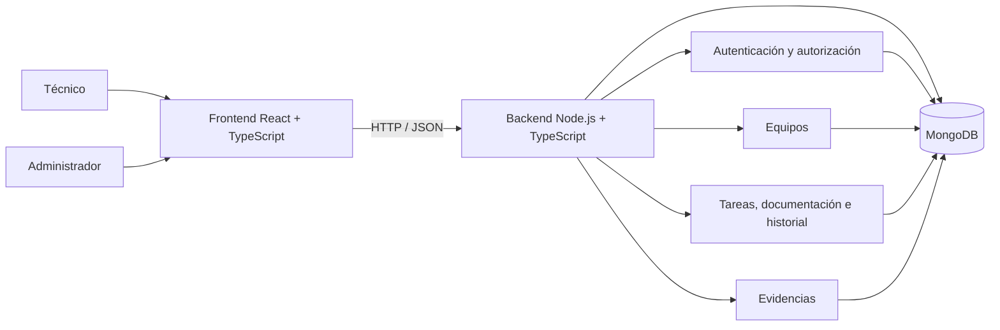
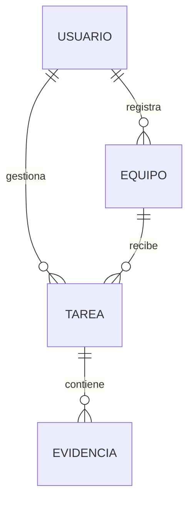

# Arquitectura de alto nivel — TechTrack

**Fuente primaria:** presentación del MVP, especialmente diapositivas 3, 4 y 11.  
**Fuente complementaria:** auditoría técnica del 11/10/2026 y estructura examinada en el commit `ff439c4`.  
**Naturaleza:** descripción arquitectónica de referencia. La verificación funcional pertenece a pruebas.

## 1. Vista de contexto

Los actores previstos son:

- **Técnico:** registra equipos, crea tareas, cambia estados, documenta intervenciones, adjunta evidencias y consulta historial.
- **Administrador:** consulta las actividades de los técnicos y datos relacionados, conforme a los permisos del sistema.

## 2. Vista de componentes



El diagrama describe responsabilidades. No representa microservicios ni servidores físicos diferentes.

## 3. Responsabilidades y trazabilidad funcional

| Área | Función | HU vinculadas |
|---|---|---|
| Identidad y autorización | Registro, acceso y permisos | HU01, HU02, HU12 |
| Equipos | Registro, selección y consulta | HU03, HU04, HU10 |
| Tareas | Creación, consulta, transición de estados | HU04, HU05, HU06, HU11 |
| Documentación técnica | Problema, diagnóstico, actividades, resultados | HU07, HU08, HU11 |
| Evidencias | Carga y recuperación de imágenes | HU09, HU11 |
| Historial | Consulta de intervenciones relacionadas con un equipo | HU10 |
| Supervisión | Consulta del trabajo registrado por técnicos | HU12 |

## 4. Estructura de proyecto acordada

```text
tech-track/
├── front/      # Interfaz web
├── back/       # API y lógica de negocio
└── docs/       # Documentación y evidencias
```

Esta estructura es coherente con la solicitud que el equipo hizo a Claude. Las subcarpetas y bibliotecas concretas se detallan en `contraste-implementacion.md`.

## 5. Modelo lógico mínimo



El diagnóstico, las actividades y el resultado pueden quedar como campos de la tarea; el historial puede consultarse a partir de las tareas del equipo. Esto refleja la implementación identificada en la auditoría, no una decisión previa documentada de forma independiente.

## 6. Consideraciones de calidad

Los componentes deben permitir verificar los criterios de aceptación de Jira:

- **Seguridad:** autenticación y permisos evaluados en el backend.
- **Integridad:** vínculos correctos entre usuarios, equipos, tareas y evidencias.
- **Trazabilidad:** recuperación de información técnica e historial sin mezclar equipos.
- **Mantenibilidad:** separación de la interfaz y la lógica del servidor.
- **Verificabilidad:** pruebas para cada funcionalidad comprometida.

Las medidas, defectos y resultados de ejecución se reportarán en `07-pruebas.md` y `09-evaluacion.md`, no en esta evidencia.
