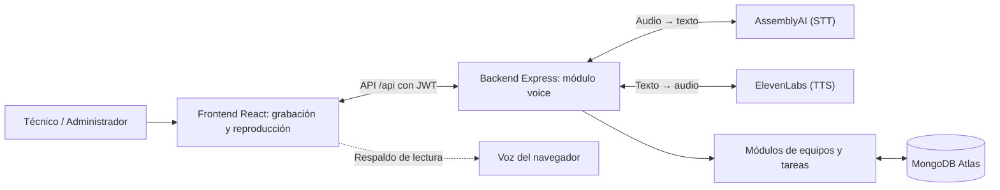

# Arquitectura — TechTrack MVP2

**Etapa:** 04. Arquitectura 
**Alcance:** Integración de voz sobre la arquitectura existente del MVP1.

## 1. Arquitectura propuesta e implementada

Se conserva la arquitectura **cliente-servidor** del MVP1: React, TypeScript y Vite en el frontend; Node.js, Express y TypeScript en el backend; y MongoDB Atlas para los datos de equipos, tareas y documentación. El MVP2 agrega servicios externos de voz, sin sustituir los módulos existentes.

## 2. Flujos de voz

| Función | Flujo | HU |
|---|---|---|
| Dictado de campos | Audio → AssemblyAI → texto editable | HU13 |
| Creación de tarea | Audio → transcripción → interpretación de equipo, título y descripción → borrador | HU14 |
| Informe completo | Audio → transcripción → distribución entre secciones del informe → revisión | HU15 |
| Asignación administrativa | Audio → borrador con técnico y equipo autorizados → confirmación | HU16 |
| Lectura y resumen | Datos de tareas → texto → ElevenLabs → audio; voz del navegador como respaldo | HU17 |

Las operaciones de voz utilizan `/api/voice/transcribe`, `/task-draft`, `/documentation-draft`, `/assignment-draft` y `/speech`. **Dictar no equivale a guardar:** el usuario revisa y confirma; la persistencia se hace mediante las rutas existentes de tareas.

## 3. Seguridad y restricciones

- Las solicitudes de voz exigen autenticación JWT; la asignación requiere rol administrador.
- Las claves de AssemblyAI y ElevenLabs permanecen en el backend, no en el navegador.
- Se validan los archivos de audio y se limita su tamaño; también se limita el uso por usuario.
- Si falla un servicio, se muestra un error controlado; la lectura puede utilizar la síntesis del navegador.
- El audio se procesa para transcribirlo, pero no se incorpora como registro permanente al modelo de datos de TechTrack.

## 4. Prompt de apoyo y decisión HITL

**Prompt de referencia para documentar la revisión arquitectónica** *(no es una transcripción literal de una interacción anterior)*:

> Analiza la arquitectura cliente-servidor de TechTrack y propone cómo integrar reconocimiento de voz con AssemblyAI y síntesis con ElevenLabs. Conserva la autenticación, los permisos, la persistencia actual y la revisión humana antes de guardar. Identifica componentes, flujos y riesgos.

**Decisión HITL:** el equipo decidió **extender la arquitectura del MVP1**, en lugar de reemplazarla, e integrar AssemblyAI y ElevenLabs a través del backend. Se mantuvo la confirmación humana de los textos interpretados y la separación entre la transcripción y el registro definitivo.

## 5. Validación

El equipo reportó pruebas funcionales de dictado y lectura y una incidencia de audio sin voz atribuida a la **selección del micrófono del navegador**. El registro del flujo real y del incidente está pendiente. Las comprobaciones automatizadas con servicios simulados no acreditan el funcionamiento de las APIs reales.
